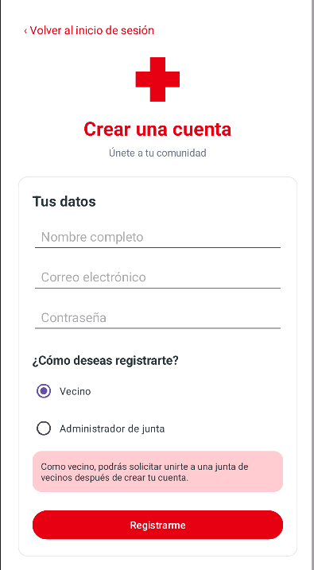
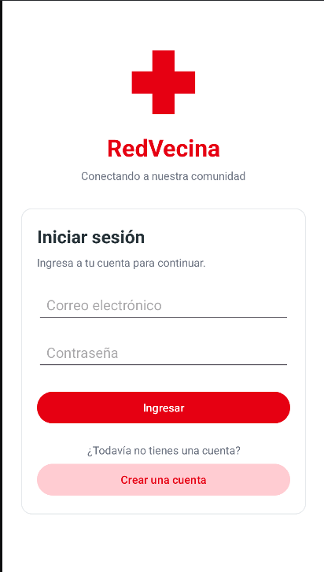
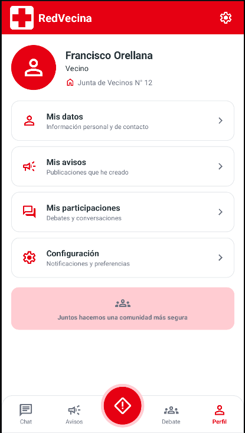
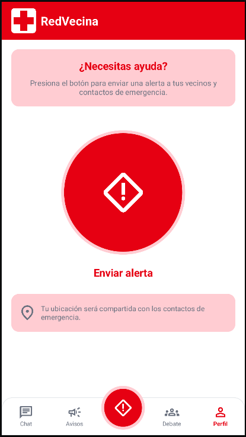

# 📱 RedVecina

**Una aplicación web orientada a toda junta vecinal que busca brindar un espacio donde administrar, comunicar y principalmente mantener segura la comunidad.**

---

## 📋 Descripción del proyecto

RedVecina es una aplicación móvil desarrollada en Android Studio, cuyo propósito es mantener a la comunidad unida y segura frente a la constante inseguridad que se vive en nuestro país.

El proyecto busca proporcionar a los usuarios una herramienta que permita administrar a los miembros de la comunidad, gestionar una mensajería en común, avisos y debates que conciernen a todos y principalmente mantenerlos comunicados y unidos antes cualquier inconveniente.

## 🎯 Objetivos

- Dar seguridad ante delitos o accidentes.
- Dar un lugar común y de fácil acceso a todo el vecindario a la información.

## ✨ Funcionalidades principales

- **Botón de emergenia:** Activar botón de emergencia para que la comunidad tenga conocimiento que estás en problemas y acudan a tu auxilio.
- **Gestión de miembros:** Administrador puede gestionar a todos los miembros de la comunidad.
- **Apartado de avisos:** Mural de avisos para que los miembros publiquen cosas importantes del vecindario.
- **Apartado de Chats:** Los miembros tendrán un grupo en común de la comunidad y abrir chats personales con el miembro que deseen.
- **Apartado de Debate:** El administrador puede publicar avisos sobre cambios, normas y debates sobre el vencindario y todos los mimebros podrán ver y opinar sobre ellos.
- **Perfíl personal:** Cada miembro tendrá su perfíl personal que lo identifíque.

## 🛠️ Tecnologías utilizadas

| Tecnología | Descripción              |
|---|--------------------------|
| Android Studio | Entorno de desarrollo    |
| Java | Lenguaje de programación |
| XML | Diseño de interfaces     |
| SQLite | Almacenamiento local     |
| Supabase / Firebase | Backend y servicios      |
| Git y GitHub | Control de versiones     |

## 📱 Requisitos del sistema

- Android Studio instalado.
- JDK compatible con la versión del proyecto.
- Android SDK.
- Dispositivo Android o emulador.
- Conexión a Internet (Para las funciones necesarias).

## ⚙️ Instalación y ejecución

1. Descargar o clonar este repositorio.
2. Abrir Android Studio.
3. Seleccionar la opción **Open**.
4. Buscar y seleccionar la carpeta del proyecto.
5. Esperar a que Gradle sincronice las dependencias.
6. Conectar un dispositivo Android o iniciar un emulador.
7. Presionar el botón **Run ▶** para ejecutar la aplicación.

### Clonar repositorio

```bash
git clone https://github.com/forellana69/RedVecina.git
```

## 📂 Estructura del proyecto

```text
NombreAplicacion/
│
├── app/
│   ├── src/
│   │   └── main/
│   │       ├── java/
│   │       │   └── com.example.myapp/
│   │       │       ├── MainActivity.java
│   │       │       └── Activity_configuracion.java
│   │       │       └── Activity_mis_avisos.java
│   │       │       └── Activity_mis_datos.java
│   │       │       └── Activity_mis_participaciones.java
│   │       │       └── AvisosActivity.java
│   │       │       └── ChatActivity.java
│   │       │       └── DebateActivity.java
│   │       │       └── EmergenciaActivity.java
│   │       │       └── LoginActivity.
│   │       │       └── NavigationHelper.java
│   │       │       └── RedVecinaDBHelper.java
│   │       │       └── RegistroActivity.java
│   │       │       └── SessionManager.java
│   │       │       └── SupabaseAuth.java
│   │       │       └── SupabaseConfig.java
│   │       │       └── SupabaseData.java
│   │       ├── res/
│   │       │   ├── drawable/
│   │       │   │   └── bg_avatar.xml
│   │       │   │   └── bg_bottom_nav.xml
│   │       │   │   └── bg_button_light.xml
│   │       │   │   └── bg_button_red.xml
│   │       │   │   └── bg_card.xml
│   │       │   │   └── bg_emergency_circle.xml
│   │       │   │   └── bg_profile_circle.xml
│   │       │   │   └── ic_campaign.xml
│   │       │   │   └── ic_chat.xml
│   │       │   │   └── ic_chevron_light.xml
│   │       │   │   └── ic_emergency.xml
│   │       │   │   └── ic_forum.xml
│   │       │   │   └── ic_groups.xml
│   │       │   │   └── ic_home.xml
│   │       │   │   └── ic_launcher_background.xml
│   │       │   │   └── ic_launcher_foreground.xml
│   │       │   │   └── ic_location.xml
│   │       │   │   └── ic_person.xml
│   │       │   │   └── ic_settings.xml
│   │       │   │   └── logo_sos.xml
│   │       │   ├── layout/
│   │       │   │   └── activity_avisos.xml
│   │       │   │   └── activity_chat.xml
│   │       │   │   └── activity_configuracion.xml
│   │       │   │   └── activity_debate.xml
│   │       │   │   └── activity_emergencia.xml
│   │       │   │   └── activity_login.xml
│   │       │   │   └── activity_main.xml
│   │       │   │   └── activity_mis_avisos.xml
│   │       │   │   └── activity_mis_datos.xml
│   │       │   │   └── activity_mis_participaciones.xml
│   │       │   │   └── activity_registro.xml
│   │       │   │   └── bottom_navigation.xml
│   │       │   ├── mipmap/
│   │       │   │   └── ic_launcher.xml
│   │       │   │   └── ic_launcher_round.xml
│   │       │   └── values/
│   │       │       └── colors.xml
│   │       │       └── strings.xml
│   │       │       └── themes.xml
│   │       │
│   │       └── AndroidManifest.xml
│   │
│   └── build.gradle
│
├── Doc/
├── gradle/
├── build.gradle
├── settings.gradle
└── README.md
```

## 🖼️ Capturas de pantalla

A continuación, se presentan algunas imágenes de las interfaces principales de la aplicación.

| Pantalla            | Captura                                                              |
|---------------------|----------------------------------------------------------------------|
| Registro            |             |
| Inicio de sesión    |                                   |
| Perfil              |                                 |
| Botón de emergencia |         |

## 👥 Roles de usuario

| Rol           | Descripción                                           |
|---------------|-------------------------------------------------------|
| Administrador | Control y gestión de vecinos y grupo de junta vecinal |
| Vecino        | gestionar perfil personal y publicar en las secciones |

## 🔐 Seguridad y permisos

La aplicación puede requerir los siguientes permisos del dispositivo:

- Permiso de Fotos.
- Permiso de Video.
- Permiso de Almacenamiento (galería).
- Permiso de Ubicación.
- Permiso de Alarma.
- Permiso de Vibración.

## 🚧 Estado del proyecto

**Estado:** En desarrollo.

### Funcionalidades pendientes

- [ ] Sección de Chat.
- [ ] Sección de Avisos.
- [ ] Sección de Debate.

## 👨‍💻 Autores

| Integrante                | Rol                                                   |
|---------------------------|-------------------------------------------------------|
| Francisco Orellana        | Desarrollador, Documentación, Planificación y Pruebas |

## 📄 Licencia

Este proyecto fue desarrollado con fines académicos y educativos.

---

**Desarrollado utilizando Android Studio y Java.**